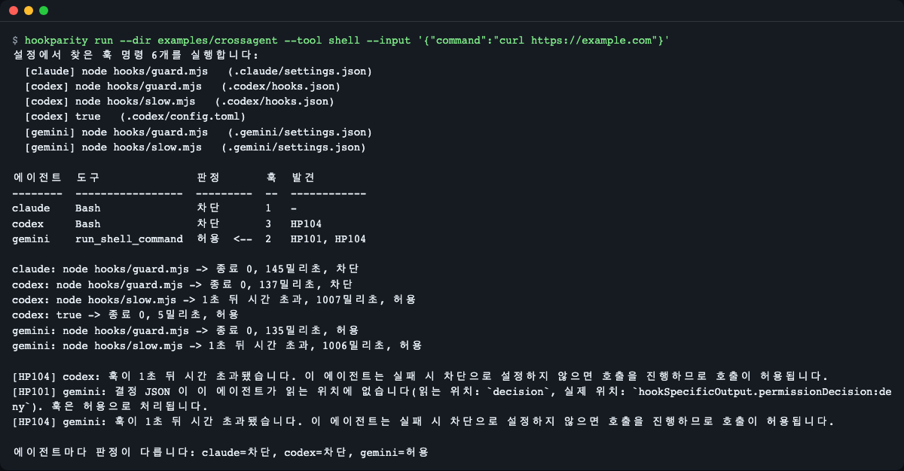
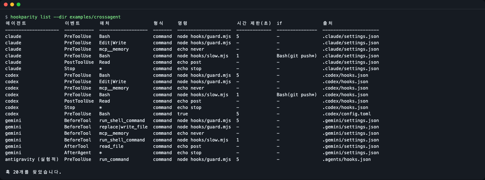
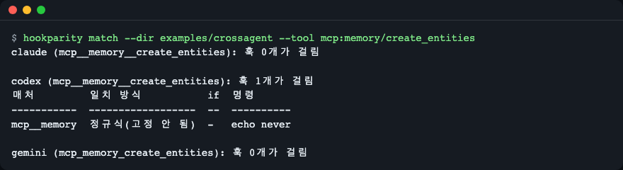
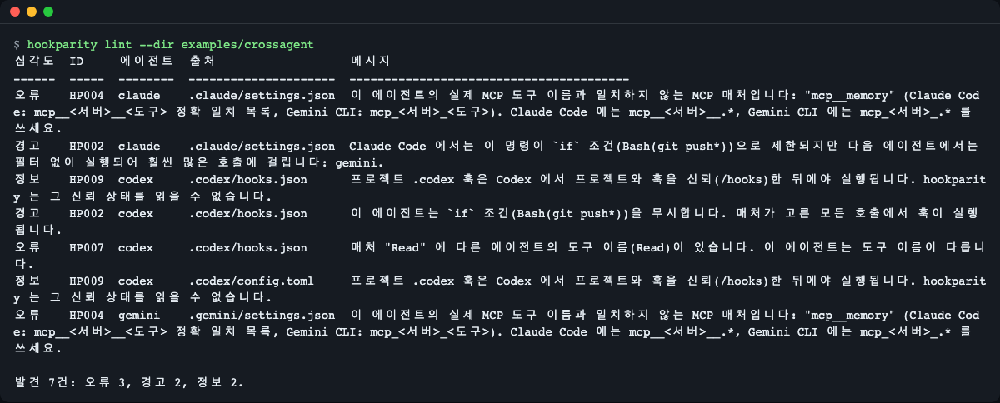
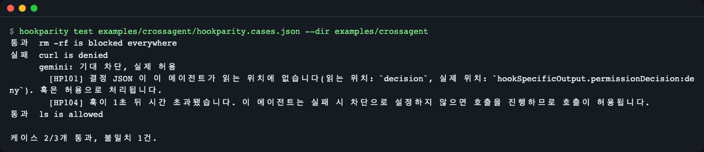
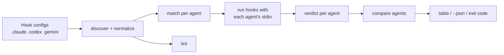

# hookparity

[English](README.md) | **한국어**

Claude Code·Codex CLI·Gemini CLI에 같은 가드레일 훅을 걸었을 때, 에이전트를 띄우지 않고도 도구 호출마다 에이전트별로 어떤 훅이 걸리는지, 그리고 각 에이전트가 훅의 답을 정말 "차단"으로 읽는지 확인합니다. 같은 검사를 CI 회귀 테스트로도 돌릴 수 있습니다.


*`run` 명령 하나: 세 에이전트, 같은 훅, 그런데 Gemini CLI만 `curl` 을 조용히 통과시킵니다(발견 HP101).*

## 왜 필요한가

훅은 에이전트가 도구(예: 셸 명령)를 쓰기 직전에 실행되는 검문소입니다. 훅이 실제로 지켜 주려면 두 가지가 모두 맞아야 합니다.

1. 검문소가 호출이 지나가는 길에 서 있어야 합니다(**매처**가 그 도구를 고름).
2. 신호가 통해야 합니다(**종료 코드나 결정 JSON**을 그 에이전트가 "차단"으로 읽음).

둘 다 에이전트마다 다릅니다. 같은 화재 경보기를 건물 세 곳에 달았는데 배선이 달라 한 곳만 조용한 것과 같습니다. 지금은 에이전트마다 세션을 띄워 위험한 명령을 시켜 보는 수밖에 없습니다. 같은 어려움이 Claude Code 이슈 트래커에 계속 올라옵니다. `Bash` 훅이 조용히 실행되지 않음([#52715](https://github.com/anthropics/claude-code/issues/52715)), `if` 필터가 아무것도 못 고름([#49703](https://github.com/anthropics/claude-code/issues/49703)), 도구 이름만 보는 매처에 `Bash(git push)` 를 씀([#36389](https://github.com/anthropics/claude-code/issues/36389)). 공식 `claude hooks test` 요청은 계획 없음으로 닫혔습니다([#36315](https://github.com/anthropics/claude-code/issues/36315)). 모두 2026-11-15 확인.

hookparity 는 각 에이전트의 공식 문서에 적힌 동작을 재현합니다([docs/support-matrix.md](docs/support-matrix.md)). 공식 문서로 만든 모델이지 실제 에이전트가 아니므로, 중요한 훅은 실제 세션에서 한 번 더 확인하세요.

## 이런 분께
- 코딩 에이전트 둘 이상에 가드레일 훅(위험 명령 차단, 비밀 검사)을 같이 쓰는 분.
- Claude Code 훅 설정을 Codex 로 복사했거나 `gemini hooks migrate --from-claude` 를 실행해서 무엇이 빠졌는지 알고 싶은 분.
- 플러그인·확장으로 훅을 배포하며 회귀 테스트가 필요한 분.

## 설치

Node.js 22.12 이상이 필요합니다(`brew install node`, 또는 https://nodejs.org). 최소 리눅스 이미지에는 `git` 과 `/bin/sh` 도 필요합니다.

```bash
git clone https://github.com/LeeGyeongPil/hookparity.git
cd hookparity
npm ci
npm run build
```

npm 에 올라간 뒤에는 클론 없이 `npx hookparity --help` 로도 실행할 수 있습니다. Windows 는 지원하지 않습니다(훅을 `/bin/sh` 로 실행).

## 빠르게 시작하기

```bash
npm start
```

`examples/crossagent` 예제(세 에이전트 훅에 `curl` 호출)를 실행합니다.

```text
About to run 6 hook command(s) from your config:
  [claude] node hooks/guard.mjs   (.claude/settings.json)
  [codex] node hooks/guard.mjs   (.codex/hooks.json)
  [codex] node hooks/slow.mjs   (.codex/hooks.json)
  [codex] true   (.codex/config.toml)
  [gemini] node hooks/guard.mjs   (.gemini/settings.json)
  [gemini] node hooks/slow.mjs   (.gemini/settings.json)

Agent   Tool               Verdict     Hooks  Findings
------  -----------------  ----------  -----  ------------
claude  Bash               block       1      -
codex   Bash               block       3      HP104
gemini  run_shell_command  allow  <--  2      HP101, HP104

claude: node hooks/guard.mjs -> exit 0, 146 ms, block
codex: node hooks/guard.mjs -> exit 0, 144 ms, block
codex: node hooks/slow.mjs -> timed out after 1s, 1010 ms, allow
codex: true -> exit 0, 6 ms, allow
gemini: node hooks/guard.mjs -> exit 0, 156 ms, allow
gemini: node hooks/slow.mjs -> timed out after 1s, 1007 ms, allow

[HP104] codex: Hook timed out after 1s; this agent lets the call proceed unless the hook is set to block on failure, so the call is allowed.
[HP101] gemini: Decision JSON is not where this agent reads it (expects `decision`, found `hookSpecificOutput.permissionDecision:deny`). The hook is treated as allow.
[HP104] gemini: Hook timed out after 1s; this agent lets the call proceed unless the hook is set to block on failure, so the call is allowed.

Agents disagree: claude=block, codex=block, gemini=allow
```

(출력은 로케일을 따릅니다. 한국어 시스템에서는 한국어로 나오며, 영어로 보려면 `npm start -- --lang en` 처럼 `-- --lang en` 을 붙이세요. 위 출력은 영어 화면입니다.)

읽는 법: Claude Code 와 Codex 는 호출을 막고 Gemini CLI 는 허용합니다. HP101 이 이유를 알려 줍니다. 훅은 `hookSpecificOutput.permissionDecision: "deny"` 로 답하는데 Gemini CLI 는 최상위 `decision` 을 읽으므로 훅이 허용으로 처리됩니다. (HP104 는 별개의 안내입니다. 느린 훅이 시간 초과됐고, 시간 초과는 차단이 아닙니다.)

`run` 은 훅 명령을 실제로 실행하며 실행 목록을 먼저 보여 줍니다. 믿을 수 없는 레포에는 아무것도 실행하지 않는 `match` 와 `lint` 만 쓰세요.

## 사용법

| 명령 | 하는 일 | 훅 실행? |
|---|---|---|
| `hookparity list` | 프로젝트(`--user` 면 사용자) 설정의 모든 훅을 초 단위 타임아웃으로 보여 줌 | 아니오 |
| `hookparity match --tool <tool>` | 가상 도구 호출 하나에 걸리는 훅을 보여 줌 | 아니오 |
| `hookparity run --tool <tool> --input '<json>'` | 걸리는 훅을 에이전트별 stdin 으로 실행하고 판정을 비교 | 예 |
| `hookparity test <cases.json...>` | 기대값 파일을 검사, 불일치면 종료 코드 1 | 예 |
| `hookparity lint` | 에이전트 간 정적 검사(HP001-HP009) | 아니오 |

공통 옵션: `--dir <path>`(프로젝트, 기본 `.`), `--agents claude,codex,gemini,antigravity`, `--json`, `--lang en|ko`, `--fail-on-divergence`(run), `--strict`(lint), `--max-timeout <sec>`(긴 훅 타임아웃을 줄임, 기본 30). `--tool` 에는 `shell`, `edit`, `write`, `read`, `mcp:<server>/<tool>`, `Bash` 같은 Claude 이름, `gemini:run_shell_command` 같은 `<agent>:<native-name>` 을 쓸 수 있습니다(`<agent>:` 이름은 그 에이전트 하나만 대상으로 합니다). 종료 코드: 0 정상, 1 불일치·lint 오류·판정 차이, 2 사용법·설정 오류.

### 1. 무엇이 걸려 있는지 보기

```bash
node dist/cli.js list --dir examples/crossagent
```


*`.claude/`·`.codex/`·`.gemini/` 의 훅이 한 표에 모입니다. Gemini 의 `5000` ms 타임아웃이 초로 보입니다.*

한 행이 훅 하나입니다: 에이전트, 이벤트, 매처, 명령, 초 단위 타임아웃, `if` 필터, 출처 파일. 이 예제의 요약 줄은 `20 hook(s) found.` 입니다(한국어 화면은 `훅 20개를 찾았습니다.`).

### 2. 도구 호출에 누가 걸리는지 보기

```bash
node dist/cli.js match --dir examples/crossagent --tool mcp:memory/create_entities
```


*같은 매처 문자열 `mcp__memory` 가 세 가지로 읽힙니다: Claude 0개, Codex 1개, Gemini 0개.*

```text
claude (mcp__memory__create_entities): 0 hook(s) fire
codex (mcp__memory__create_entities): 1 hook(s) fire
gemini (mcp_memory_create_entities): 0 hook(s) fire
```

Claude Code 는 글자·숫자·`_`·`-`·공백·`,`·`|` 만으로 된 매처를 정확한 이름 목록으로 취급해 `mcp__memory` 는 아무것도 못 고릅니다. Codex 는 앞뒤를 고정하지 않는 정규식으로 보아 걸립니다. Gemini 는 MCP 도구 이름이 `mcp_<server>_<tool>` 입니다. `match` 는 아무것도 실행하지 않습니다.

### 3. 실행 없이 위험 찾기

```bash
node dist/cli.js lint --dir examples/crossagent
```


*발견 7개: 오류 3, 경고 2, 정보 2. 종료 코드 1.*

예를 들어 HP004(실제 도구 이름과 맞지 않는 MCP 매처), HP002(무시하는 에이전트에서 사라지는 `if` 필터), HP007(다른 에이전트의 도구 이름을 쓴 매처)을 알려 줍니다. [Lint 규칙](#lint-규칙)을 보세요.

### 4. CI 테스트로 만들기

케이스 파일에 도구 호출과 에이전트별 기대 동작을 적습니다.

```json
{
  "cases": [
    {"name": "rm -rf is blocked everywhere", "tool": "shell", "input": {"command": "rm -rf build"}, "expect": {"*": "block"}},
    {"name": "curl is denied", "tool": "shell", "input": {"command": "curl https://example.com"}, "expect": {"claude": "block", "codex": "block", "gemini": "block"}},
    {"name": "ls is allowed", "tool": "shell", "input": {"command": "ls"}, "expect": {"*": "allow"}}
  ]
}
```

```bash
node dist/cli.js test examples/crossagent/hookparity.cases.json --dir examples/crossagent
```


*`2/3 cases passed, 1 mismatch(es).` 실패한 케이스는 에이전트와 발견 항목을 알려 줍니다.*

`examples/fixed` 는 Gemini 훅이 Gemini 가 읽는 자리에 답하도록 고친 같은 구성이며 케이스가 모두 통과합니다(`3/3 cases passed, 0 mismatch(es).`, 종료 코드 0).

GitHub Actions 예:

```yaml
name: hooks
on: [push, pull_request]
jobs:
  hooks:
    runs-on: ubuntu-latest
    steps:
      - uses: actions/checkout@v7
      - uses: actions/setup-node@v7
        with:
          node-version: 24
      - run: npx hookparity lint --strict
      - run: npx hookparity test hookparity.cases.json
```

## 에이전트별 차이

공식 문서에서 재현한 사실이며 2026-11-15 확인(Claude Code 문서 2.1.325, codex-cli 0.169.0, gemini-cli 0.68.0)입니다. Antigravity CLI 는 experimental 로만 읽습니다. 전체 표와 출처: [docs/support-matrix.md](docs/support-matrix.md).

| 항목 | Claude Code | Codex CLI | Gemini CLI |
|---|---|---|---|
| 도구 실행 전 이벤트 | `PreToolUse` | `PreToolUse` | `BeforeTool` |
| 매처 | 단순 문자만: 정확한 이름 목록, 아니면 정규식 | 정규식(앞뒤 고정 안 함) | 정규식(앞뒤 고정 안 함) |
| MCP 도구 이름 | `mcp__<server>__<tool>` | `mcp__<server>__<tool>` | `mcp_<server>_<tool>` |
| `if` 필터 | 지원 | 무시 | 무시 |
| 차단 신호 | exit 2 또는 `permissionDecision: "deny"` | exit 2 또는 `permissionDecision: "deny"` | exit 2 또는 최상위 `decision: "deny"` |
| 타임아웃 단위 | 초 | 초 | 밀리초 |

요령: exit 2 는 어디서나 차단, exit 1 은 차단이 아님, 시간 초과는 호출을 통과시킴(Claude Code 는 `onFailure: "block"` 일 때만 차단).

## 동작 원리



- 에이전트별 설정을 찾아 정규화합니다(타임아웃은 초).
- 에이전트별 매처 규칙으로 가상 도구 호출에 걸릴 훅을 정합니다.
- 걸린 훅을 `/bin/sh` 로 실행하며, 그 에이전트 모양의 stdin 을 줍니다.
- 종료 코드와 stdout 을 그 에이전트 규칙으로 허용·차단으로 바꿉니다.
- 판정을 비교해 다르면 판정 차이로 알립니다.

## Lint 규칙

| ID | 뜻 |
|---|---|
| HP001 | 도구 이벤트가 아닌 곳의 `if` 는 실행되지 않음(Claude Code 는 도구 이벤트에서만 `if` 평가) |
| HP002 | Codex/Gemini 는 `if` 를 무시해 Claude Code 보다 훨씬 많은 호출에서 훅이 실행됨 |
| HP003 | 매처에 `Bash(git push)` 같은 권한 규칙 문법을 씀. 매처는 도구 이름만 봄 |
| HP004 | MCP 매처가 이 에이전트의 실제 MCP 도구 이름과 일치하지 않음 |
| HP005 | 시간 제한 숫자의 단위가 틀린 것 같음: Claude Code·Codex 는 초(5000 같은 값은 1시간 넘게 기다림), Gemini CLI 는 밀리초(5 같은 값은 5밀리초만 기다림) |
| HP006 | 이 에이전트에 없는 이벤트라 훅이 실행되지 않음 |
| HP007 | 매처에 다른 에이전트의 도구 이름이 있음(예: Codex 에서 `Read`) |
| HP008 | 매처가 올바른 정규식이 아님 |
| HP009 | Codex 프로젝트 훅은 Codex 에서 프로젝트와 훅을 신뢰한 뒤에야 실행됨(hookparity 는 그 상태를 읽을 수 없음) |
| HP101 | 결정 JSON 이 이 에이전트가 읽는 위치에 없음 |
| HP102 | 2 가 아닌 비 0 종료(차단 아님) |
| HP103 | 결정 `ask` 를 이 에이전트가 지원하지 않음 |
| HP104 | 훅 시간 초과 |
| HP105 | 종료 0 인데 stdout 이 JSON 객체가 아님 |

해당 규칙의 정확한 메시지는 `node dist/cli.js lint --dir examples/crossagent --lang ko` 로 볼 수 있습니다.

## 언어

출력은 영어 또는 한국어입니다. 우선순위는 `--lang en|ko`, `HOOKPARITY_LANG`, `LC_ALL`, `LC_MESSAGES`, `LANG` 순이고, `ko` 로 시작하면 한국어, 그 밖에는 영어입니다. `NO_COLOR=1` 이면 색을 끕니다.

```bash
HOOKPARITY_LANG=ko node dist/cli.js list --dir examples/crossagent
```

## 언제 쓰나

- 잘 맞는 경우: "이 훅이 걸리고 그 답이 에이전트마다 차단으로 읽히나?"를 오프라인으로 빨리 확인하거나, 그 상태를 CI 로 지키고 싶을 때.
- 실제 세션의 대체재가 아님: hookparity 는 문서에 적힌 동작을 모델링합니다. 중요한 판단은 에이전트에서 직접 확인하세요.
- 다른 도구: Claude Code 설정을 Gemini CLI 로 변환하려면 `gemini hooks migrate --from-claude`([Gemini CLI 훅 문서](https://geminicli.com/docs/hooks/)), 각 에이전트의 공식 레퍼런스는 [Claude Code 훅 문서](https://code.claude.com/docs/en/hooks) 를 보세요.

## 한계

- 동작은 위 버전에 고정된 문서에서 재현합니다. Codex 의 0·2 외 종료 코드와 Antigravity 의 모든 종료 코드는 문서에 없어 그 판정은 가정입니다.
- 사용자 수준 설정은 `--user` 또는 `--home` 일 때만 읽고 수정하지 않습니다.
- Codex 프로젝트 훅은 Codex 에서 신뢰 설정이 필요하며 hookparity 는 그 상태를 읽을 수 없습니다(HP009).
- 같은 에이전트의 걸린 훅은 실제 에이전트처럼 동시에 실행하고 결과 순서는 고정합니다. 시간 제한을 넘긴 훅은 종료시킵니다.
- Windows 는 지원하지 않습니다.

## 자주 겪는 문제

| 증상 | 원인 | 해결 |
|---|---|---|
| `Cannot find module .../dist/cli.js` | 아직 빌드하지 않음 | `npm run build` |
| 파일 경로와 함께 종료 코드 2 | 설정 파일이 올바른 JSON/TOML 이 아님 | 메시지에 나온 파일을 고침 |
| 기대한 도구에 `0 hook(s) fire` | 매처가 그 에이전트의 도구 이름과 맞지 않음 | `lint` 실행, HP004·HP007 확인 |
| `run` 이 몇 초 멈춤 | 느린 훅 | `--max-timeout 5` 로 줄임 |

## 개발

```bash
npm ci
npm test
```

버그·제안은 이슈로 남겨 주세요. 변경 기록은 [CHANGELOG.md](CHANGELOG.md).

## 라이선스

MIT
