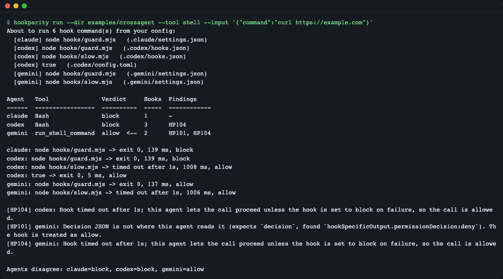
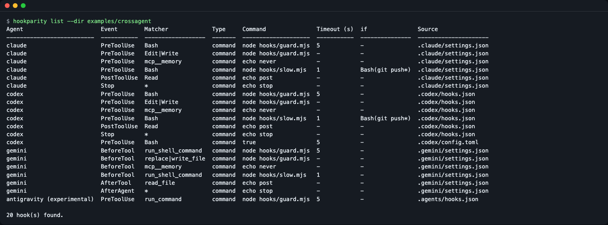
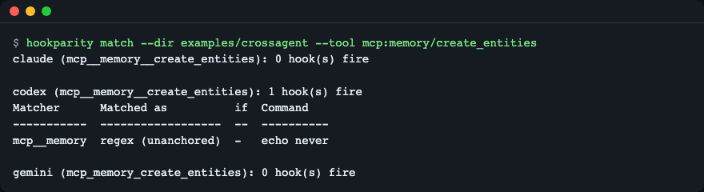
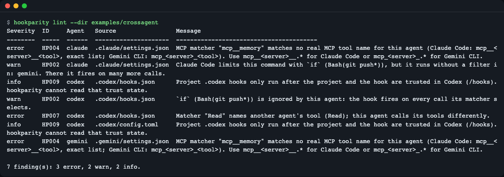
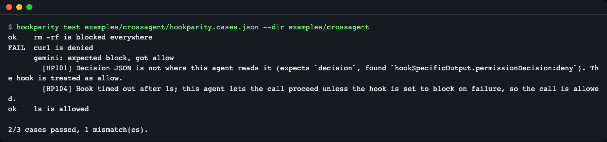
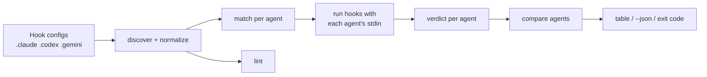

# hookparity

**English** | [한국어](README.ko.md)

Put the same guardrail hooks on Claude Code, Codex CLI and Gemini CLI, then see, without launching any agent, which hooks fire for a tool call under each agent's rules and whether each agent actually reads the hook's answer as a block. The same checks run in CI as a regression test.


*One `run` command: three agents, the same hook, and Gemini CLI quietly lets `curl` through (finding HP101).*

## Why

A hook is a checkpoint that runs right before an agent uses a tool (for example, before a shell command). Two separate things have to be true for it to protect you:

1. The checkpoint stands where the call passes (the **matcher** selects the tool).
2. The signal gets through (the **exit code or decision JSON** is read as "block" by that agent).

Both differ between agents. It is like installing the same fire alarm in three buildings and finding one of them is silent because its wiring is different. Today the only way to know is to start each agent and ask it to do something dangerous. The same trouble keeps coming back in the Claude Code issue tracker: a `Bash` hook that silently does not fire ([#52715](https://github.com/anthropics/claude-code/issues/52715)), an `if` filter that matches nothing ([#49703](https://github.com/anthropics/claude-code/issues/49703)), and `Bash(git push)` written in a matcher, which only sees tool names ([#36389](https://github.com/anthropics/claude-code/issues/36389)). The official request for a `claude hooks test` command was closed as not planned ([#36315](https://github.com/anthropics/claude-code/issues/36315)). All checked 2026-11-15.

hookparity reproduces the documented behavior of each agent (see [docs/support-matrix.md](docs/support-matrix.md)). It is a model built from official docs, not the real agents, so confirm important hooks once in a real session.

## Who it is for
- You use guardrail hooks (dangerous-command blocking, secret checks) on more than one coding agent.
- You copied a Claude Code hook setup to Codex, or ran `gemini hooks migrate --from-claude`, and want to know what was lost.
- You publish hooks in a plugin or extension and want a regression test for them.

## Install

Requires Node.js 22.12 or newer (`brew install node`, or see https://nodejs.org). On a minimal Linux image you also need `git` and `/bin/sh`.

```bash
git clone https://github.com/LeeGyeongPil/hookparity.git
cd hookparity
npm ci
npm run build
```

After the npm release you can also run it without cloning: `npx hookparity --help`. Windows is not supported (hooks run through `/bin/sh`).

## Quick start

```bash
npm start
```

This runs the bundled example in `examples/crossagent` (a `curl` call against three agents' hooks):

```text
About to run 6 hook command(s) from your config:
  [claude] node hooks/guard.mjs   (.claude/settings.json)
  [codex] node hooks/guard.mjs   (.codex/hooks.json)
  [codex] node hooks/slow.mjs   (.codex/hooks.json)
  [codex] true   (.codex/config.toml)
  [gemini] node hooks/guard.mjs   (.gemini/settings.json)
  [gemini] node hooks/slow.mjs   (.gemini/settings.json)

Agent   Tool               Verdict     Hooks  Findings
------  -----------------  ----------  -----  ------------
claude  Bash               block       1      -
codex   Bash               block       3      HP104
gemini  run_shell_command  allow  <--  2      HP101, HP104

claude: node hooks/guard.mjs -> exit 0, 146 ms, block
codex: node hooks/guard.mjs -> exit 0, 144 ms, block
codex: node hooks/slow.mjs -> timed out after 1s, 1010 ms, allow
codex: true -> exit 0, 6 ms, allow
gemini: node hooks/guard.mjs -> exit 0, 156 ms, allow
gemini: node hooks/slow.mjs -> timed out after 1s, 1007 ms, allow

[HP104] codex: Hook timed out after 1s; this agent lets the call proceed unless the hook is set to block on failure, so the call is allowed.
[HP101] gemini: Decision JSON is not where this agent reads it (expects `decision`, found `hookSpecificOutput.permissionDecision:deny`). The hook is treated as allow.
[HP104] gemini: Hook timed out after 1s; this agent lets the call proceed unless the hook is set to block on failure, so the call is allowed.

Agents disagree: claude=block, codex=block, gemini=allow
```

(The output follows your locale. On a Korean system it prints in Korean; add `-- --lang en` to `npm start` to force English.)

Read it as: Claude Code and Codex block the call, Gemini CLI allows it. HP101 says why: the hook answers with `hookSpecificOutput.permissionDecision: "deny"`, but Gemini CLI reads a top-level `decision`. The hook is then treated as allow. (HP104 is a separate note: a slow hook timed out, and a timeout does not block.)

The `run` command really runs the hook commands and lists them first. Use `match` and `lint` (they run nothing) on repositories you do not trust.

## Usage

| Command | What it does | Runs hooks? |
|---|---|---|
| `hookparity list` | Show every hook found in project (and with `--user`, user) configs, timeouts in seconds | no |
| `hookparity match --tool <tool>` | Show which hooks fire for one virtual tool call | no |
| `hookparity run --tool <tool> --input '<json>'` | Run matching hooks with each agent's stdin and compare verdicts | yes |
| `hookparity test <cases.json...>` | Check expectations from a cases file; exit 1 on mismatch | yes |
| `hookparity lint` | Static cross-agent checks (HP001-HP009) | no |

Common options: `--dir <path>` (project, default `.`), `--agents claude,codex,gemini,antigravity`, `--json`, `--lang en|ko`, `--fail-on-divergence` (run), `--strict` (lint), `--max-timeout <sec>` (shorten long hook timeouts, default 30). `--tool` accepts `shell`, `edit`, `write`, `read`, `mcp:<server>/<tool>`, Claude names such as `Bash`, or `<agent>:<native-name>` such as `gemini:run_shell_command` (an `<agent>:` name targets only that agent). Exit codes: 0 ok, 1 mismatch / lint error / divergence, 2 usage or config error.

### 1. See what is configured

```bash
node dist/cli.js list --dir examples/crossagent
```


*Hooks from `.claude/`, `.codex/` and `.gemini/` in one table. Gemini's `5000` ms timeouts show as seconds.*

Each row is one hook: agent, event, matcher, command, timeout in seconds, `if` filter and source file. The summary line is `20 hook(s) found.` for this example.

### 2. See who fires for a tool call

```bash
node dist/cli.js match --dir examples/crossagent --tool mcp:memory/create_entities
```


*The same matcher string `mcp__memory` is read three ways: Claude 0 hooks, Codex 1, Gemini 0.*

```text
claude (mcp__memory__create_entities): 0 hook(s) fire
codex (mcp__memory__create_entities): 1 hook(s) fire
gemini (mcp_memory_create_entities): 0 hook(s) fire
```

Claude Code treats a matcher made only of letters, digits, `_`, `-`, space, `,` and `|` as an exact name list, so `mcp__memory` matches nothing. Codex treats it as an unanchored regex, so it matches. Gemini names MCP tools `mcp_<server>_<tool>`. `match` runs nothing.

### 3. Find risks without running anything

```bash
node dist/cli.js lint --dir examples/crossagent
```


*Seven findings: 3 error, 2 warn, 2 info. Exit code 1.*

It reports for example HP004 (an MCP matcher that matches no real tool name), HP002 (an `if` filter that is lost on agents that ignore it) and HP007 (a matcher using another agent's tool name). See [Lint rules](#lint-rules).

### 4. Turn it into a CI test

A cases file lists tool calls and what each agent should do:

```json
{
  "cases": [
    {"name": "rm -rf is blocked everywhere", "tool": "shell", "input": {"command": "rm -rf build"}, "expect": {"*": "block"}},
    {"name": "curl is denied", "tool": "shell", "input": {"command": "curl https://example.com"}, "expect": {"claude": "block", "codex": "block", "gemini": "block"}},
    {"name": "ls is allowed", "tool": "shell", "input": {"command": "ls"}, "expect": {"*": "allow"}}
  ]
}
```

```bash
node dist/cli.js test examples/crossagent/hookparity.cases.json --dir examples/crossagent
```


*`2/3 cases passed, 1 mismatch(es).` The failing case names the agent and the finding.*

`examples/fixed` is the same setup with Gemini's hook answering in the place Gemini reads; its cases pass (`3/3 cases passed, 0 mismatch(es).`, exit 0).

GitHub Actions example:

```yaml
name: hooks
on: [push, pull_request]
jobs:
  hooks:
    runs-on: ubuntu-latest
    steps:
      - uses: actions/checkout@v7
      - uses: actions/setup-node@v7
        with:
          node-version: 24
      - run: npx hookparity lint --strict
      - run: npx hookparity test hookparity.cases.json
```

## How agents differ

Facts reproduced from official docs, checked 2026-11-15 (Claude Code docs for 2.1.325, codex-cli 0.169.0, gemini-cli 0.68.0). Antigravity CLI is read as experimental. Full table and sources: [docs/support-matrix.md](docs/support-matrix.md).

| Topic | Claude Code | Codex CLI | Gemini CLI |
|---|---|---|---|
| Pre-tool event | `PreToolUse` | `PreToolUse` | `BeforeTool` |
| Matcher | simple characters: exact name list, else unanchored regex | unanchored regex | unanchored regex |
| MCP tool name | `mcp__<server>__<tool>` | `mcp__<server>__<tool>` | `mcp_<server>_<tool>` |
| `if` filter | supported | ignored | ignored |
| Block signal | exit 2 or `permissionDecision: "deny"` | exit 2 or `permissionDecision: "deny"` | exit 2 or top-level `decision: "deny"` |
| Timeout unit | seconds | seconds | milliseconds |

Rules of thumb: exit 2 blocks everywhere; exit 1 never blocks; a timeout lets the call proceed (Claude Code blocks only with `onFailure: "block"`).

## How it works



- Configs of each agent are found and normalized (timeouts in seconds).
- The matcher rules of each agent decide which hooks would fire for the virtual tool call.
- Matching hooks run via `/bin/sh` with a stdin payload shaped like that agent's.
- The exit code and stdout are turned into allow or block using that agent's rules.
- Verdicts are compared; a difference is reported as divergence.

## Lint rules

| ID | Meaning |
|---|---|
| HP001 | `if` on a non-tool event never runs (Claude Code evaluates `if` only on tool events) |
| HP002 | `if` is ignored by Codex/Gemini, so the hook fires on more calls than under Claude Code |
| HP003 | Matcher uses permission-rule syntax such as `Bash(git push)`; matchers see only the tool name |
| HP004 | MCP matcher matches no real MCP tool name for this agent |
| HP005 | Timeout number looks like the wrong unit: Claude Code and Codex read seconds (a value like 5000 waits over an hour), Gemini CLI reads milliseconds (a value like 5 waits 5 ms) |
| HP006 | Event does not exist for this agent, so the hook never fires |
| HP007 | Matcher names another agent's tool (for example `Read` under Codex) |
| HP008 | Matcher is not a valid regular expression |
| HP009 | Codex project hooks run only after the project and hook are trusted in Codex (hookparity cannot read that state) |
| HP101 | Decision JSON is not where this agent reads it |
| HP102 | Non-zero exit other than 2 (not a block) |
| HP103 | Decision `ask` is not supported by this agent |
| HP104 | Hook timed out |
| HP105 | Exit 0 but stdout is not a JSON object |

Run `node dist/cli.js lint --dir examples/crossagent --lang en` to see the exact message of each rule that applies.

## Language

Output is English or Korean. The order is `--lang en|ko`, then `HOOKPARITY_LANG`, then `LC_ALL`, `LC_MESSAGES`, `LANG`. A value starting with `ko` gives Korean, anything else gives English. `NO_COLOR=1` turns colors off.

```bash
HOOKPARITY_LANG=ko node dist/cli.js list --dir examples/crossagent
```

## When to use it

- Good fit: you want a quick, offline answer to "does this hook fire, and is its answer read as a block, on each agent?", or a CI test that keeps it so.
- Not a replacement for a real session: hookparity models documented behavior. Confirm with the agent itself when a decision matters.
- Other tools: to convert settings from Claude Code to Gemini CLI, use `gemini hooks migrate --from-claude` (see the [Gemini CLI hooks docs](https://geminicli.com/docs/hooks/)); to read each agent's own reference, see the [Claude Code hooks docs](https://code.claude.com/docs/en/hooks).

## Limits

- Behavior is reproduced from documentation, pinned to the versions above. Codex exit codes other than 0 and 2, and all Antigravity exit codes, are undocumented; those verdicts are assumptions.
- User-level configs are read only with `--user` or `--home`, and never modified.
- Codex project hooks need to be trusted in Codex; hookparity cannot read that state (HP009).
- Matching hooks run concurrently, like real agents, and results keep a stable order; a hook that outlives its timeout is killed.
- Windows is not supported.

## Troubleshooting

| Symptom | Cause | Fix |
|---|---|---|
| `Cannot find module .../dist/cli.js` | Not built yet | `npm run build` |
| exit 2 with a file path | A config file is not valid JSON/TOML | Fix the file named in the message |
| `0 hook(s) fire` for a tool you expected | Matcher does not match that agent's tool name | Run `lint`; see HP004 and HP007 |
| `run` hangs a few seconds | A hook is slow | Lower it with `--max-timeout 5` |

## Development

```bash
npm ci
npm test
```

Report bugs or ideas as issues. Changes are listed in [CHANGELOG.md](CHANGELOG.md).

## License

MIT
